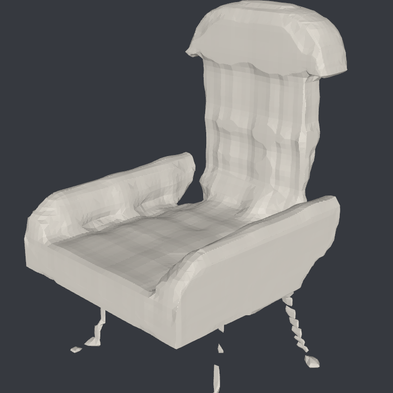

# ShapERuntime

A Swift package that runs the Shap-E text-to-3D and image-to-3D pipeline on Apple platforms with [MLX](https://github.com/ml-explore/mlx-swift).

The library product is `ShapERuntime`. The executable product is `ShapECLI`. Model weights are not in this repository.



Shaded preview of the Metal mesh from the run in [Tested on](#tested-on). The OBJ has positions and faces. The picture uses a neutral gray material and stands the Z-up mesh upright.

## Install

This repository has no version tag yet, so the snippet tracks `main`.

```swift
// Package.swift
dependencies: [
    .package(url: "https://github.com/signalnotnoise/shap-e-mlx-swift.git", branch: "main"),
],
targets: [
    .target(
        name: "YourTarget",
        dependencies: [
            .product(name: "ShapERuntime", package: "shap-e-mlx-swift"),
        ]
    ),
]
```

`import ShapERuntime` in the client target. Platforms declared by this package are macOS 14, iOS 17, and visionOS 1.

## Usage

`bundleURL` is the downloaded runtime bundle directory (`manifest.json` at its root). `bpeURL` is `bpe_simple_vocab_16e6.txt.gz` in that same directory.

```swift
import ShapERuntime

let runtime = try ShapERuntime(
    modelBundleURL: bundleURL,
    bpeVocabularyURL: bpeURL
)

let mesh = try await runtime.generate(prompt: "a red chair")
let vertices = try mesh.verticesArray() // [Float], length V * 3
let faces = try mesh.facesArray()       // [Int32], length F * 3
```

`generate(prompt:)` returns one `ShapEMeshResult`. The `batchSize` overload returns `[ShapEMeshResult]`. `generate(image:)` takes a `CGImage` or an `MLXArray` and returns `[ShapEMeshResult]`. Text weights load in `init`. Image weights (`clip_vision` and `image300m`) load on the first image call.

`ShapECLI` is a separate executable for local parity dumps and a CPU-versus-Metal mesh comparison. When `--bpe` is omitted, it uses `bpe_simple_vocab_16e6.txt.gz` in the bundle directory, next to `manifest.json`. Pass `--bpe` to choose a different file. That path wins when the file exists.

```bash
ShapECLI --ab-mesh \
  --bundle runtime_bundle \
  --prompt "a red chair"
```

`run_tests.sh` builds with `xcodebuild` because a plain `swift test` or `swift run` can miss MLX's `default.metallib`. This repository's CI uses that same `xcodebuild` path. The CLI was not run in CI.

## Weights

Weights come from [signalNotNoise/shap-e-mlx](https://huggingface.co/signalNotNoise/shap-e-mlx), pinned to revision `d71f70a09b9c03535188d006a719edda5c19a6eb`. That revision currently lists 1,104 files. Upstream release notes record the snapshot as 5,143,254,750 bytes. This package does not re-measure the payload, and CI does not download it.

`scripts/fetch_weights.py` downloads that revision and checks every line in `checksums.sha256` (64 hex characters, two spaces, relative path). A mismatch or a missing checksummed file is a failure.

```bash
python3 -m pip install huggingface_hub
python3 scripts/fetch_weights.py --output runtime_bundle
```

The directory is gitignored. To check a directory you already have, without contacting Hugging Face:

```bash
python3 scripts/fetch_weights.py --verify-only --output runtime_bundle
```

`--text-only` downloads `clip_text`, `text300m`, `diffusion`, `decoder_params`, `renderer`, `licenses/*`, and the root files (`manifest.json`, the BPE vocabulary, checksums, provenance, LICENSE, README). That set is what `generate(prompt:)` loads. `generate(image:)` also needs `clip_vision` and `image300m`, which `--text-only` omits. Text-only verification still requires every checksum entry in that scope. A missing manifest, tokenizer, license, or text-family tensor fails. Entries outside that scope, including the image families, are skipped only when the file is absent. Files that are present still have to match.

## Platforms and what is tested

| Platform | Declared | Tested in this repository's CI |
| --- | --- | --- |
| macOS 14+ | yes | yes, GitHub-hosted `macos-26`, Xcode 26.6, `xcodebuild test -scheme ShapERuntime-Package -destination platform=macOS` |
| iOS 17+ | yes | no |
| visionOS 1+ | yes | no |

The macOS job does not download weights. Unit tests use `Tests/ShapERuntimeTests/Fixtures/runtime_bundle_stub/`, a small random-weight fixture with no trained parameters. Three CLIP tokenizer parity tests throw `XCTSkip` unless `bpe_simple_vocab_16e6.txt.gz` is available via `SHAP_E_BPE`, `SHAP_E_BUNDLE`, or `runtime_bundle/bpe_simple_vocab_16e6.txt.gz`. `ClipBPELocationTests` checks the omitted `--bpe` fallback with a temporary file and does not read the weight bundle. No test in this package loads the full weight bundle. Linux cannot build the MLX Metal shaders, so there is no Linux job.

## Tested on

Local run on an Apple M3 Max (14 CPU cores, 10 performance and 4 efficiency, 30 GPU cores, 36 GB unified memory), macOS 27.3 (26C5047e), Xcode 27.0 (27A5252f), Swift 6.4 (swiftlang-6.4.0.33.1).

`xcodebuild test -scheme ShapERuntime-Package -destination platform=macOS` executed 40 tests, 0 failures. Three CLIP tokenizer tests skipped without the vocabulary file, then passed against `bpe_simple_vocab_16e6.txt.gz` from the weight bundle: `testEncodeParityForRepresentativePrompts`, `testTokenizeParityAndPadding`, `testTokenizeTruncationKeepsEndOfText`.

`scripts/fetch_weights.py --revision v0.1.0` verified 1,102 checksummed files from [signalNotNoise/shap-e-mlx](https://huggingface.co/signalNotNoise/shap-e-mlx). Tag `v0.1.0` resolves to commit `d71f70a09b9c03535188d006a719edda5c19a6eb`.

Release `ShapECLI`, from `xcodebuild -configuration Release` with mlx-swift 0.31.3 (MLX `default.metallib` and this package's marching-cubes Metal library):

```bash
ShapECLI --ab-mesh \
  --bundle ~/.cache/shap-e-mlx \
  --prompt "a red chair" \
  --seed 7 \
  --steps 64 \
  --grid 64
```

`/usr/bin/time -l` reported 39.42 seconds real, 1.29 seconds user, 2.19 seconds sys, peak memory footprint 5,489,169,280 bytes, and maximum resident set size 5,856,296,960 bytes. The run printed guidance 15, the CLI default. The Metal mesh and the CPU mesh matched: 9,882 vertices, 19,684 faces, closed, 0 boundary edges. Metal marching cubes took 0.052 seconds. CPU marching cubes took 0.816 seconds.

The picture at the top is a 768 by 768 shaded render of that Metal OBJ. The file stores positions and faces. The render uses a neutral gray material and a -90 degree rotation about X so the Z-up mesh stands upright. `powermetrics` requires root on this machine, so this section has no GPU-utilization percentage.

## Limitations

- Mesh generation quality, Torch parity, and CPU-versus-Metal mesh checks need the downloaded weights. They are not part of the unit tests or CI. `ShapECLI --parity` and `--image-parity` also expect reference files (for example `case.json` and `python_*.npy`) that are not in this repository.
- The stub fixture has no `clip_vision` or `image300m` tensors, so it cannot exercise image generation.
- iOS and visionOS are declared and are not built here. `.spi.yml` asks the Swift Package Index to build those Apple platforms and to generate documentation for `ShapERuntime`. This CI workflow does not generate documentation, and there is no checked-in DocC catalog.
- There is no semver tag. Swift Package Index listing also requires a public repository. Visibility of this repository is left as it is.

## Attribution

This package is MIT licensed. Copyright (c) 2026 Ismael Alex Otero. [signalnotnoise](https://github.com/signalnotnoise) maintains the project. See [LICENSE](LICENSE).

The Swift sources are a port of [Shap-E](https://github.com/openai/shap-e) (MIT, Copyright (c) 2023 OpenAI) and depend on the CLIP BPE vocabulary from [CLIP](https://github.com/openai/CLIP) (MIT, Copyright (c) 2021 OpenAI). Those license texts are [licenses/Shap-E.txt](licenses/Shap-E.txt) and [licenses/CLIP.txt](licenses/CLIP.txt). MLX and mlx-swift are MIT licensed dependencies from Apple and are not vendored. Full notices are in [NOTICE](NOTICE).

## Provenance

Copied from [`shap_e/swift`](https://github.com/signalnotnoise/apple-mlx-foundations/tree/v0.1.0/shap_e/swift) in [apple-mlx-foundations](https://github.com/signalnotnoise/apple-mlx-foundations) tag `v0.1.0`, commit `018215715177943fe72cea8e540bc7b80dcb593f`. That directory matches `main` of the source repository. Its public history is one snapshot commit (author Alex Otero, 2026-11-17), so this package is a clean copy rather than a `git filter-repo` extraction. Two test paths were updated for the new layout: the non-SwiftPM fixture fallback, and the CLIP vocabulary lookup, which now skips when the weight bundle is absent instead of searching a monorepo virtualenv that does not exist here. `ShapECLI` also gained a fallback to `<bundle>/bpe_simple_vocab_16e6.txt.gz` when `--bpe` is omitted. That fallback was not in the source tree.
