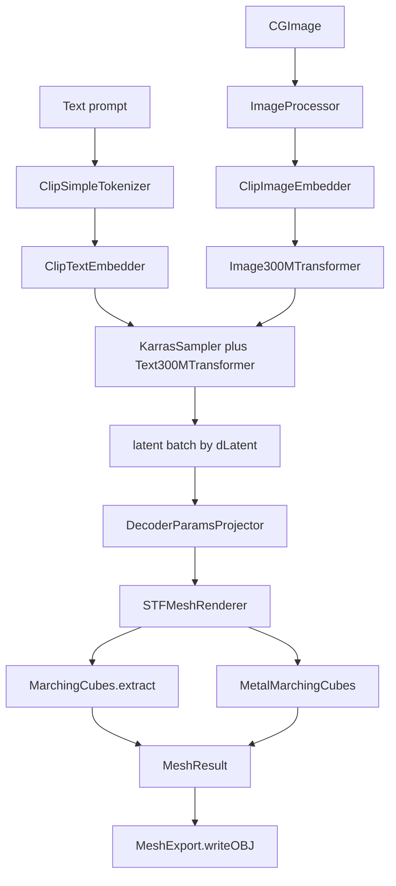

# Knowledge graph

Verified source commit: `7ed124d1a9b408a84d3b96f0df66c53dd48b3de6` on `main`.

That SHA is the commit recorded when the graph was measured. `scripts/verify_docs.py` does not ask git whether this commit is an ancestor of `HEAD`. It checks the cited lines in the working tree.

Machine-readable index: [knowledge-graph.json](knowledge-graph.json).

## Dataflow

`dLatent` and `nCtx` are bundle metadata (`RuntimeArtifactBundle.swift:140-141`), not literals in the sampler.

## Where to find things

| Task | Location |
| --- | --- |
| Tokenizer | `Sources/ShapERuntime/Models/embeddings/ClipSimpleTokenizer.swift:29`, `Sources/ShapERuntime/ClipBPELocation.swift#ClipBPELocation` |
| Text encoder | `Sources/ShapERuntime/Models/embeddings/ClipTextEmbedder.swift#ClipTextEmbedder.embedText` |
| Diffusion sampling | `Sources/ShapERuntime/KarrasSampler.swift:316`, `Sources/ShapERuntime/Text300MTransformer.swift#Text300MTransformer.predict` |
| Latent decoding | `Sources/ShapERuntime/DecoderParamsProjector.swift#DecoderParamsProjector.project`, `Sources/ShapERuntime/STFMeshRenderer.swift#STFMeshRenderer.nerstfForward` |
| Marching cubes, CPU and Metal | `Sources/ShapERuntime/MarchingCubes.swift#MarchingCubes.extract`, `Sources/ShapERuntime/MetalMarchingCubes.swift#MetalMarchingCubes.setup`, `Sources/ShapERuntime/MCTable.swift#MC_TABLE` |
| Mesh export | `Sources/ShapERuntime/MeshExport.swift#MeshExport.writeOBJ`, `Sources/ShapERuntime/MeshTopology.swift:22-112` |
| CLI and A/B mesh | `Sources/ShapECLI/main.swift#runMeshAB`, `Sources/ShapECLI/main.swift#resolveBPE` |
| Weights fetch and verify | `scripts/fetch_weights.py:34-61`, `scripts/fetch_weights.py:180-218` |
| Tests | `Tests/ShapERuntimeTests/RuntimeBundleFixture.swift:3-25`, `Tests/ShapERuntimeTests/ShapEMeshResultArrayTests.swift#ShapEMeshResultArrayTests`, `run_tests.sh:17-20` |
| CI and manifest | `Package.swift:1-22`, `.github/workflows/ci.yml:36-48`, `Package.resolved:4-11` |

More detail: [wiki/01-Architecture-and-Dataflow.md](wiki/01-Architecture-and-Dataflow.md), [wiki/02-Weights-and-Bundle.md](wiki/02-Weights-and-Bundle.md), [wiki/03-Build-CI-and-Testing.md](wiki/03-Build-CI-and-Testing.md), [wiki/04-Memory-and-Performance.md](wiki/04-Memory-and-Performance.md).
